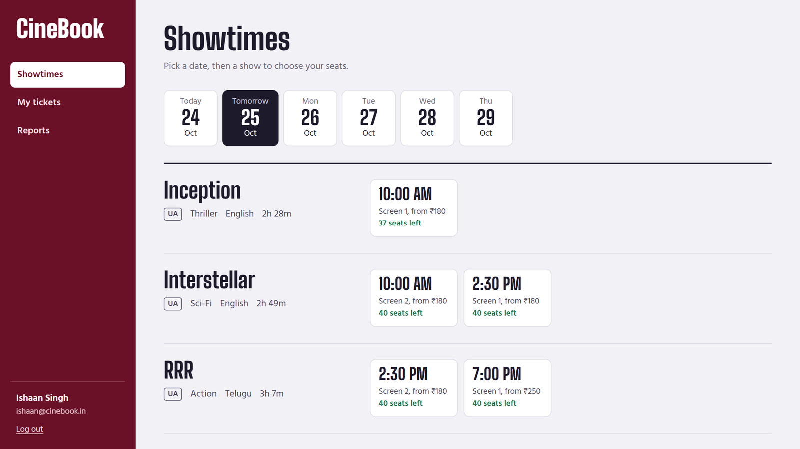
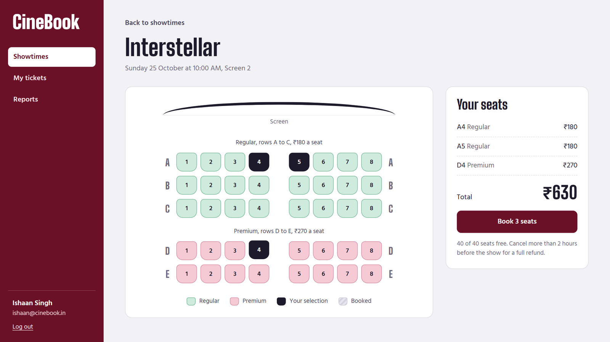
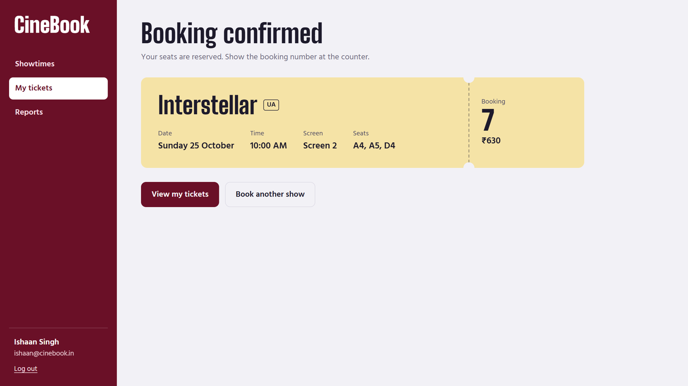
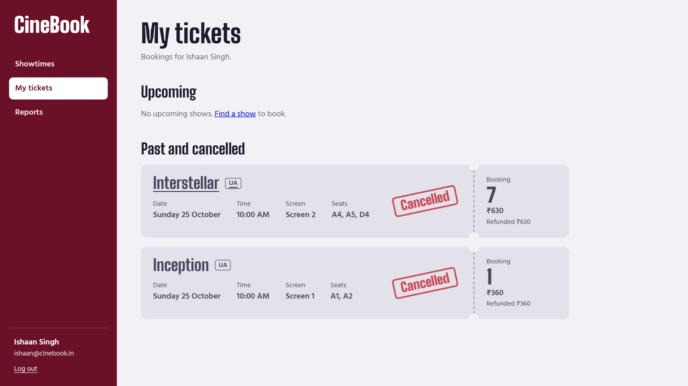
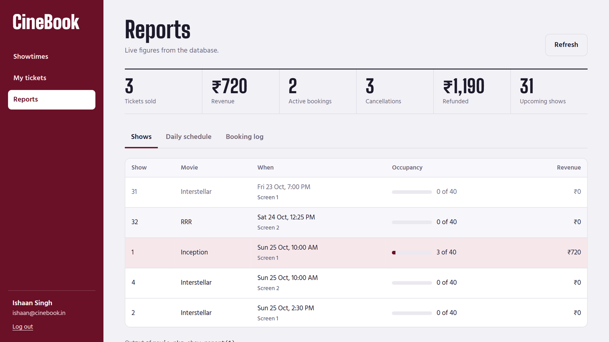
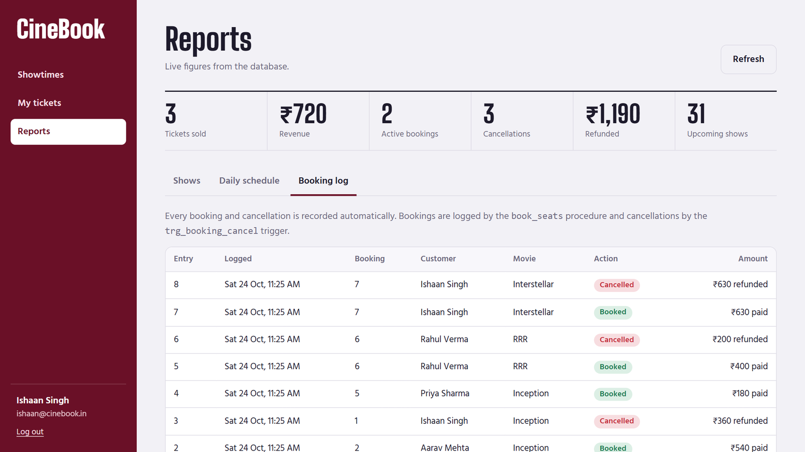
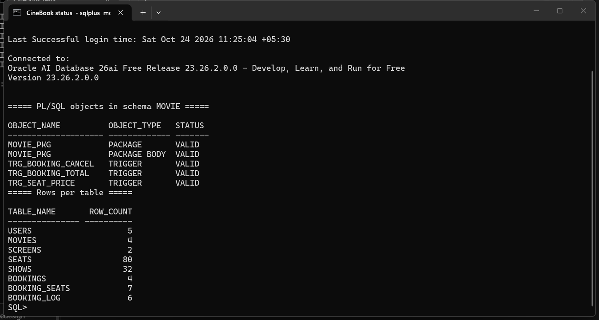
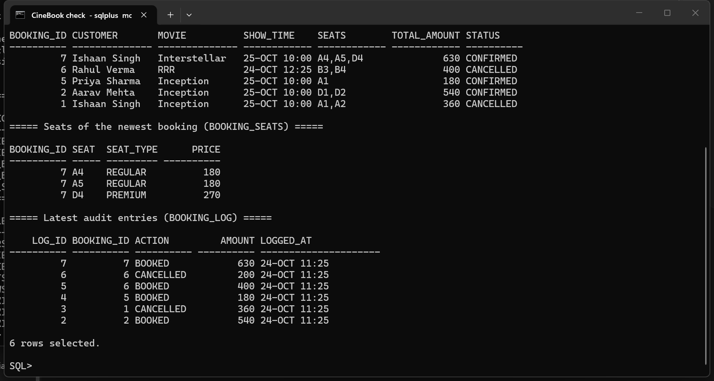
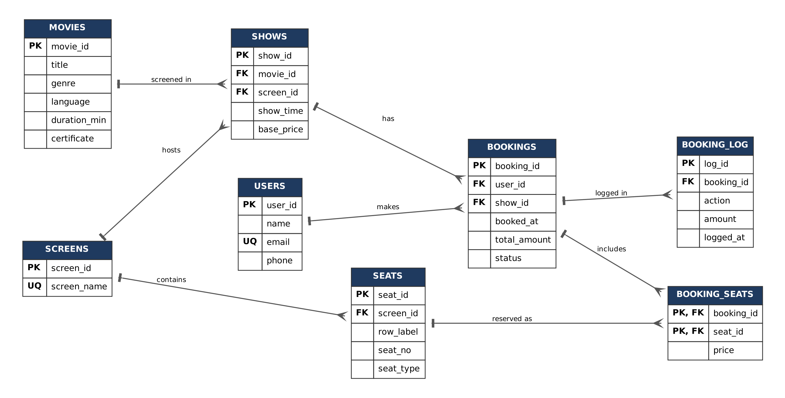

# CineBook — Movie Ticket Booking

BCSE302P Database Systems Lab mini project · Ishaan Singh (24BCE0671)

Oracle AI Database 26ai Free + PL/SQL · Python FastAPI (python-oracledb) · desktop web front-end

```
cinebook/
├── api/
│   ├── main.py          FastAPI server: REST API under /api, serves the web app
│   └── desktop.py       opens the app in its own window
├── web/                 front-end (HTML, CSS, JavaScript, bundled fonts)
├── sql/
│   ├── 00_user.sql      create the MOVIE schema (run once, as SYSDBA)
│   ├── 01_schema.sql    8 tables, named constraints, indexes
│   ├── 02_data.sql      sample users, movies, screens, 80 seats, shows
│   ├── 03_plsql.sql     movie_pkg package + 3 triggers
│   ├── 04_tests.sql     16 test cases, PASS/FAIL + summary
│   ├── run_all.sql      runs 01 → 04
│   ├── reset.sql        drops everything, then runs 01 → 04
│   ├── check.sql        latest bookings, seats and log (proof of storage)
│   ├── show_all.sql     every table, constraint, object and row
│   └── test_results.txt output of the last test run
└── docs/                ER diagram, architecture diagram and screenshots
```

## Screenshots

| Showtimes | Seat selection |
|---|---|
|  |  |
| **Booking confirmed** | **My tickets (cancelled with refund)** |
|  |  |
| **Reports with PL/SQL output** | **Booking log (written by procedure and trigger)** |
|  |  |
| **Package and triggers VALID in SQL*Plus** | **The app's booking, read in SQL*Plus** |
|  |  |



## 1. Database

From the `sql` folder:

```
sqlplus / as sysdba
@00_user.sql
exit

sqlplus movie/movie123@localhost:1521/FREEPDB1
@run_all.sql
```

- `03_plsql.sql` ends with a status table: the package, package body and 3 triggers must all say **VALID**.
- `04_tests.sql` ends with **16 of 16 test cases passed**.
- To start over with fresh data, use `@reset.sql` instead of `@run_all.sql`.

## 2. Run the app

```
pip install -r api/requirements.txt
python api/main.py
```

The app is served at http://localhost:8000. To open it in its own window instead of a browser tab, run `python api/desktop.py`. Fonts are bundled, so it works offline. Database connection settings can be changed with the `DB_USER`, `DB_PASS` and `DB_DSN` environment variables.

Pages:

| Page | What it shows | Database work |
|---|---|---|
| Log in | pick a sample account or type an email | `users` |
| Showtimes | next 5 days, every movie's shows with seats left | `available_seats()` |
| Seat selection | live seat map, regular and premium pricing, total | `seat_map()` REF CURSOR, `book_seats()`, both price triggers |
| Booking confirmed | printed ticket with booking number | `bookings`, `booking_seats` |
| My tickets | upcoming, past and cancelled bookings, cancel with refund | `cancel_booking()`, `trg_booking_cancel`, `refund_calc()` |
| Reports | totals, per-show occupancy and revenue, PL/SQL report output, audit log | `show_report()` and `daily_schedule()` via DBMS_OUTPUT, `booking_log` |

While the server is running, interactive documentation for every endpoint is available at `/docs` (for example http://localhost:8000/docs).

## Rubric coverage

| Requirement | Where |
|---|---|
| Functions | `seat_price`, `available_seats`, `refund_calc`, `seat_map` |
| Procedures | `book_seats`, `cancel_booking`, `show_report`, `daily_schedule` |
| Package | `movie_pkg` (spec + body, with a package constant) |
| Triggers | `trg_seat_price` (BEFORE INSERT), `trg_booking_total` (AFTER INSERT), `trg_booking_cancel` (AFTER UPDATE with WHEN) |
| Cursors | explicit (`show_report`), parameterised FOR loop (`daily_schedule`), REF CURSOR (`seat_map`) |
| Exceptions | `RAISE_APPLICATION_ERROR` codes below, `NO_DATA_FOUND` handling, rollback on failure |
| Test cases | `04_tests.sql`, TC01–TC16 |
| Front-end integrated with the database | `web/` + `api/main.py` |

## Business rules

- Premium seats (rows D, E) cost 1.5 × base price, set by trigger.
- A booking holds 1 to 6 seats.
- A seat can't be booked twice for the same show; the show row is locked during booking so two people can't grab the same seat at once.
- Bookings for shows that have started are rejected.
- Cancelling more than 2 hours before the show refunds 100%, within 2 hours 50%; after it starts, it's blocked.
- Cancelled bookings free their seats. Every booking and cancellation is recorded in `booking_log`.

| Code | Meaning |
|---|---|
| -20001 | Show has already started (booking) |
| -20002 | Invalid seat |
| -20003 | Seat already booked |
| -20004 | No seats selected |
| -20005 | Show not found |
| -20006 | Booking already cancelled |
| -20007 | Booking not found |
| -20008 | Show has already started (cancel) |
| -20009 | More than 6 seats |
